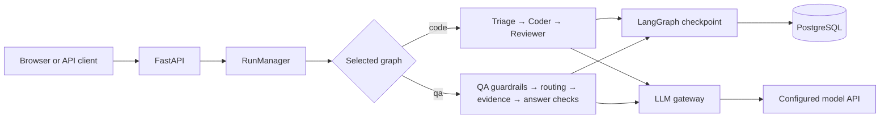
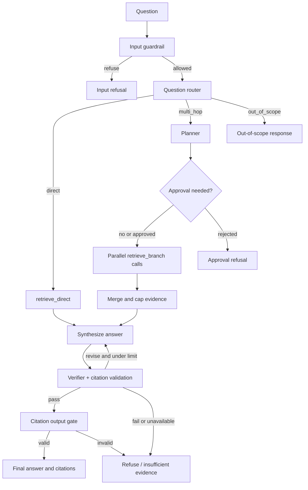
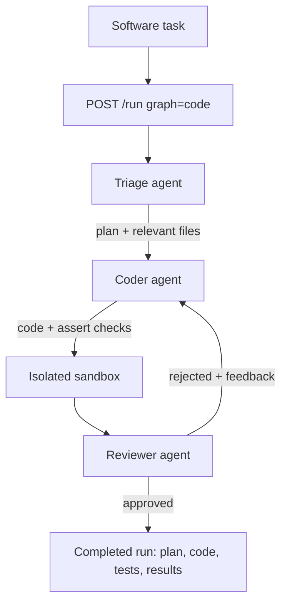

# AegisFlow: Interview Study Guide

## Project in one minute

AegisFlow is a service for running AI-assisted work in a controlled, trackable way. It has two workflows: one turns a software task into a proposed code change and checks it; the other answers questions using a set of indexed documents. Both workflows use a shared model connection and save workflow progress so a run can continue after interruption. The service exposes these capabilities through an HTTP API.

The code workflow is **Triage → Coder → Reviewer**. The documentation question-answering (QA) workflow checks a question, chooses a direct or multi-part search path, gathers relevant document passages, drafts an answer, and checks whether its claims and citations are supported.

## Architecture at a glance

```text
Client
  └─ API service ── Run manager ── Workflow engine ── Model gateway ── Model provider
         │                 │               ├─ Code workflow ── Isolated code runner
         │                 │               └─ QA workflow ── Document retrieval
         └─────────────────┴──── Saved run state (PostgreSQL)

Document files ── Clean and split ── Create searchable representations ── Document index
```

The two workflows are distinct paths through the service. The QA retrieval capability is not currently exposed as a tool inside the code-fix workflow.

## Component-by-component

### 1. API service

**Objective:** Provide the entry point clients use to start and manage work.

**Contribution to the pipeline:** Accepts requests, validates basic inputs, passes work to the run manager, and returns run status or streamed results. It also exposes document-question answering, document indexing, health checks, and live workflow events.

**Inputs and outputs:** Receives a task description, a question, or a document-indexing request. It returns a run identifier and status; status details include available plan, code, answer, and usage information. QA answers can stream in pieces and include citation information. Indexing reports job status and document/chunk counts.

**If it were absent:** There would be no standard way for another application or user to start a workflow, check its progress, or receive its result. The underlying workflow logic could still be called directly, but would not be a usable service interface.

### 2. Run manager

**Objective:** Coordinate background runs and present a consistent view of them.

**Contribution to the pipeline:** Selects the code or QA workflow, starts it asynchronously, collects live events, retrieves saved workflow state, and supports resuming or approving runs that are waiting for a decision.

**Inputs and outputs:** Receives a validated task or question from the API. It creates a run identifier and returns status, progress events, errors, or workflow results. Durable workflow details come from the saved state; live events and some error details are held in memory.

**If it were absent:** The API would need to manage workflow execution, state lookup, and event delivery itself. Long-running work and recovery would become harder to coordinate, and the interface would be more tightly coupled to workflow internals.

### 3. Workflow engine and saved run state

**Objective:** Define the order of work, decisions, loops, and recovery points.

**Contribution to the pipeline:** Runs each workflow as connected steps. It saves state as steps complete, allowing an interrupted run to continue from its last saved point rather than repeating all completed work. The same saved-state approach supports both code and QA runs.

**Inputs and outputs:** Receives the starting task/question and the latest workflow state. Each step adds information such as a plan, draft, evidence, feedback, token usage, or approval choice. The engine produces the final state or pauses at a decision point.

**If it were absent:** The sequence and retry logic would have to be manually coordinated. A process restart could lose progress, and it would be harder to inspect or resume a run consistently.

### 4. Code workflow: Triage agent

**Objective:** Understand the requested software change and turn it into a practical plan.

**Contribution to the pipeline:** Starts the code workflow. It identifies the likely work and files, then passes a plan to the coder.

**Inputs and outputs:** Takes the user's task description. Returns a written implementation plan and a list of relevant files.

**If it were absent:** The coder would receive the raw request without a dedicated planning step. It could miss important parts of the task or produce changes with less direction.

### 5. Code workflow: Coder agent

**Objective:** Produce a proposed implementation and checks for the requested change.

**Contribution to the pipeline:** Turns the triage plan into code and a small set of executable assertions. If the reviewer rejects an attempt, the coder receives the feedback and previous attempt and tries again.

**Inputs and outputs:** Takes the plan, relevant-file names, and (on later attempts) reviewer feedback and previous code/checks. Returns a code proposal and test proposal.

**If it were absent:** The workflow could still analyze and review a task, but it would not generate the proposed change that the rest of this pipeline evaluates.

### 6. Code workflow: Reviewer agent

**Objective:** Decide whether a proposed change is acceptable based on execution evidence and review.

**Contribution to the pipeline:** Sends the proposed code and checks to the isolated runner, then considers the execution result when deciding to approve or return feedback. Approval ends the workflow; rejection sends the work back to the coder.

**Inputs and outputs:** Takes the code and test proposals. Produces an approval decision and feedback for another attempt if needed.

**If it were absent:** The pipeline would have no independent quality gate or feedback loop. It could return generated code without checking whether the included checks run successfully.

### 7. Isolated code runner

**Objective:** Execute generated code in a constrained environment.

**Contribution to the pipeline:** Runs the proposed code and assertions in a temporary container with network access disabled, a memory limit, and a timeout. The reviewer uses the result as evidence.

**Inputs and outputs:** Takes the code and checks as one runnable script. Returns whether execution succeeded and the output or error details.

**If it were absent:** The reviewer would have to judge code from text alone. Runtime failures and failing assertions would be easier to miss, and running generated code directly in the service would remove an important containment boundary.

### 8. Guardrails and usage controls

**Objective:** Keep workflow retries and model usage bounded, and avoid repeating identical expensive work where caching applies.

**Contribution to the pipeline:** Limits coder attempts, tracks cumulative model-token usage against a per-run budget, and caches identical sandbox calls during a run. The QA workflow also applies input checks, injection screening, evidence limits, and refusal behavior for unsafe or unsupported requests.

**Inputs and outputs:** Receives the current run state, usage totals, and proposed tool-call inputs. It either permits work to continue, reuses a cached result, or stops/redirects the run when a limit or check is reached.

**If it were absent:** Runs could retry indefinitely, consume uncontrolled model usage, repeat identical executions, or proceed with inputs and answers that should have been refused or limited.

### 9. Model gateway and structured responses

**Objective:** Give the workflows one consistent way to communicate with supported language-model services.

**Contribution to the pipeline:** Sends prompts, handles transient provider failures with retries, supports streaming, tracks usage, and requests responses in defined formats. It validates model output against expected fields and can ask for a corrected response when it does not fit.

**Inputs and outputs:** Takes messages and request settings from an agent or QA step. Returns model text or structured results, usage details, and provider errors when a request cannot complete.

**If it were absent:** Each workflow component would need its own provider-specific connection, retry behavior, output checks, and usage tracking. Switching compatible model providers would also require more changes across the application.

### 10. QA input checks and question router

**Objective:** Decide whether a question can proceed and which QA path best fits it.

**Contribution to the pipeline:** Checks question size and common instruction-override attempts, then uses a model to classify the question as direct, multi-part, or out of scope. Unsafe or unclassifiable requests are refused rather than sent through answer generation.

**Inputs and outputs:** Takes the user's question. Returns a refusal, an out-of-scope result, or a route for direct retrieval or multi-part planning.

**If it were absent:** Every question would follow the same path. Unsafe or unsupported requests would have fewer early checks, and questions that need multiple pieces of evidence would not receive a dedicated plan.

### 11. QA planner and parallel retrieval

**Objective:** Break a question requiring several facts into smaller searches.

**Contribution to the pipeline:** Produces a small set of sub-questions, retrieves evidence for each, and combines the results. Depending on the plan size and estimated cost, the workflow can pause for approval before doing this work.

**Inputs and outputs:** Takes the original question and produces sub-questions. Each search returns ranked document passages; the workflow combines them into a bounded evidence set for answering.

**If it were absent:** Multi-part questions would depend on a single search for the entire wording. The system could miss evidence that is easier to find by searching for each part separately.

### 12. Document ingestion and preparation

**Objective:** Turn the source documentation into consistent, searchable pieces.

**Contribution to the pipeline:** Reads supported documentation files, cleans and organizes their text, splits it into meaningful chunks, records source and heading context, and builds searchable representations for the index.

**Inputs and outputs:** Takes the local documentation collection. Produces document chunks with identifiers, text, source details, headings, and search data that retrieval can use.

**If it were absent:** The QA workflow would have no prepared document collection to search. Raw documents would need to be searched and interpreted on every question, making retrieval less consistent and less efficient.

### 13. Document index and retrieval

**Objective:** Find the document passages most relevant to a question.

**Contribution to the pipeline:** Stores document chunks and their search data in PostgreSQL. Depending on configuration, it searches by meaning, by text terms, or by a combination; an optional reranking step can reorder likely matches. Retrieval returns passage identifiers, which are used to fetch the source text and metadata.

**Inputs and outputs:** Takes a question and requested result count. Returns ranked passage identifiers and then the corresponding passage text, source, and heading information.

**If it were absent:** The QA model would have to answer from its general training or from content pasted directly into the request. Answers would not be grounded in the project's indexed documents and reliable source citations would not be available.

### 14. QA answer synthesis, verification, and citations

**Objective:** Produce a concise answer supported by retrieved evidence and avoid presenting unsupported claims as facts.

**Contribution to the pipeline:** Supplies retrieved passages to the model, asks it to answer from those passages, checks citation markers, and uses a separate verification step to assess whether the answer is supported. The workflow can revise the draft within limits or return “insufficient evidence.”

**Inputs and outputs:** Takes the question and bounded evidence passages. Produces a draft, validated citations linked to passage identifiers, a verification result, and a final answer or refusal.

**If it were absent:** Retrieval results would not be turned into a user-ready answer, or the answer would lack a check that its claims match the retrieved material. Citation quality and safe handling of missing evidence would be weaker.

### 15. PostgreSQL persistence

**Objective:** Store durable workflow progress and the searchable document collection.

**Contribution to the pipeline:** Keeps workflow checkpoints so runs can be inspected and resumed. It also stores the document index used by QA retrieval.

**Inputs and outputs:** Receives workflow state updates and indexed document data. Supplies saved state to resumed runs and searchable document records to the retrieval layer.

**If it were absent:** Workflow progress would be much more vulnerable to process restarts, and the document index would need another persistent store or would have to be rebuilt and held elsewhere.

## End-to-end interview walkthroughs

## Detailed execution paths: request to response

This section describes the implemented paths in more detail. AegisFlow has
two workflows that share the API, run manager, LangGraph state/checkpointing,
guardrails, and LLM gateway, but solve different problems. The QA graph and
the simpler streaming RAG chat endpoint are also distinct entry points.

### Shared service lifecycle



At application startup, FastAPI loads configuration, opens the PostgreSQL
checkpointer, and constructs the run manager. If RAG is enabled, startup also
initializes the pgvector schema, loads the local embedding model, creates the
configured retrieval runtime, and wires it into the QA graph. The generation
model is accessed through the same OpenAI-compatible gateway abstraction, so
provider/model configuration is centralized.

The UI starts durable graph runs with `POST /run`, then listens to
`/ws/events/{run_id}` for node updates and reads the accumulated state from
`GET /runs/{run_id}`. Checkpoints are persisted in PostgreSQL. The run
manager's live event buffer is in memory, so old event history may not be
available after a server restart even though checkpointed state remains.

### QA graph used by the workflow screen



#### 1. Input and first guardrail

The request supplies a question. The guardrail first applies deterministic
checks: it rejects questions over the configured character limit (4,000 by
default) and matches common instruction-override patterns. If those checks
pass, a structured-output injection classifier checks whether the user is
trying to override system instructions or extract hidden prompts. If this
classifier errors or returns malformed output, the workflow fails closed and
refuses the request. This is a safety filter, not a general factuality check.

#### 2. Route selection

A structured LLM classifier chooses one of three routes:

- **`direct`**: one focused question; retrieve evidence for the original wording.
- **`multi_hop`**: comparison or multiple related facts; plan distinct searches.
- **`out_of_scope`**: unrelated to the indexed technical documentation; return a
  scope-limited response without retrieval or answer synthesis.

If the router cannot return a valid structured decision, the implementation
falls back to `direct`, avoiding a routing-format failure from stopping an
otherwise valid question.

#### 3. Direct retrieval

For the `direct` route, the QA graph calls the configured RAG runtime. The
current default is dense retrieval over structure-aware chunks:

1. The local `BAAI/bge-small-en-v1.5` embedder converts the question to a
   normalized 384-dimensional vector (with BGE's query instruction prefix).
2. PostgreSQL/pgvector ranks chunk vectors by cosine distance and returns the
   requested top-k IDs.
3. The graph fetches the chunk text and metadata (source, heading path, and
   document identity) by ID.
4. Duplicate chunks are removed and evidence is trimmed to the configured
   serialized-token budget (3,000 tokens by default). Full corpus rows are not
   copied wholesale into graph state.

The runtime can also be configured for hybrid search, which fuses dense
rankings with PostgreSQL full-text rankings using reciprocal rank fusion, or
hybrid plus a cross-encoder reranker. PostgreSQL `ts_rank_cd` is full-text
ranking, not BM25. The RAG retrieval model is separate from the generation
model: changing the generation model does not directly alter the dense index
or its ranking algorithm.

#### 4. Multi-hop planning and parallel evidence gathering

For `multi_hop`, the planner returns two to four independent sub-questions.
The graph estimates the token cost from the plan and configured context,
answer, and verifier budgets. It pauses for explicit approval if the plan
exceeds the automatic branch limit or projected token threshold. On approval,
the sub-questions fan out to concurrent retrieval tasks (concurrency defaults
to four). The graph interleaves branch results by rank, deduplicates them, and
applies the same evidence-token cap before synthesis. Rejection returns
`insufficient evidence` without running those searches.

#### 5. Answer synthesis

The answer model receives the original question plus numbered evidence
contexts. Each context includes source and heading metadata. The prompt treats
retrieved text as untrusted data (so instructions embedded in documents are
not followed), requires citations in `[n]` form, and says to answer exactly
`insufficient evidence` when the sources do not support an answer. The answer
call is bounded by the configured maximum output tokens.

#### 6. Verification, revision, and citation gate

The verifier performs two separate checks:

- A deterministic check verifies each citation marker is in range and maps it
  to the corresponding retrieved chunk. A non-empty answer other than
  `insufficient evidence` must contain at least one citation.
- A model-based faithfulness judge scores whether the answer's factual claims
  are supported by the evidence. The default threshold is 0.85.

If the score is below threshold or citations are invalid, the graph can send
the verifier's feedback back to synthesis (up to two revisions by default).
If it still fails, or the verifier is unavailable or malformed, the graph
fails closed with `insufficient evidence`. Passing both checks leads to the
output gate, which rechecks that the final answer is non-empty and its citation
markers are valid. The workflow result includes the final answer, citations
mapped to chunk IDs, route, verdict, and available usage/verification details.

The green checks in the UI mean the corresponding graph nodes emitted an
update and the run finished; they do not show all intermediate evidence or
prove correctness by themselves. For example, “Citation gate” is the final
deterministic output validation, while “Verifier” is the evidence-support
assessment plus citation mapping.

### Streaming RAG chat endpoint versus QA graph

The frontend also has a direct RAG chat path using `POST /query`. It retrieves
evidence, builds a numbered-context prompt, streams generated text as SSE
`token` events, then sends citation metadata and timing/usage information in
`citations` and `done` events. This endpoint does **not** execute the QA
LangGraph's router, planner, model faithfulness verifier, revision loop, or
output-gate nodes. It validates citation marker ranges after generation and
returns that metadata. This distinction matters when describing the UI:
streaming chat and the workflow screen are separate paths with different
checks.

### Tri-Agent code workflow: input to proposed patch



1. **API and run manager:** The client submits a task description. The API
   creates a `code-<uuid>` run and the run manager invokes the code graph in a
   background task.
2. **Triage:** The triage LLM returns a structured implementation/reproduction
   plan and likely relevant file names. This is planning metadata; it does not
   itself edit repository files.
3. **Coder:** The coder receives that plan and file list and returns a complete
   runnable Python code proposal plus plain `assert` checks. It is not a diff
   applied directly to the user's checkout. After a rejection, it also gets
   reviewer feedback and the previous attempt.
4. **Sandbox execution:** The reviewer concatenates code and assertions and
   executes them in the isolated Docker sandbox with network disabled,
   resource/time limits, and no dependency on project files. The result is
   execution evidence, not a full project integration test.
5. **Review and loop:** The reviewer LLM sees both proposals and sandbox logs,
   then returns a structured approve/reject decision and feedback. Rejection
   loops to the coder, subject to the recursion limit and token budget.
6. **Result and recovery:** The graph checkpoints state in PostgreSQL. The UI
   can show the plan, proposed code, tests, execution results, and review
   outcome. `/runs/{run_id}` exposes current state; resume/approval endpoints
   support interrupted or paused workflows.

The Tri-Agent workflow and QA graph are coordinated by the same platform, but
the code agents do not currently invoke RAG as a repository-search tool.
The workflow generates and checks a proposal; a person still reviews and
applies any desired change.

### Interview answer in 60 seconds

“AegisFlow exposes two LangGraph workflows behind FastAPI. In the code path,
Triage turns a task into a plan, Coder proposes runnable code and assertions,
and Reviewer executes them in a network-isolated Docker sandbox before
approving or sending feedback for a bounded retry. In the QA path, guardrails
screen the question, a router selects direct or multi-hop retrieval, and the
RAG runtime searches structure-aware document chunks in pgvector using local
BGE embeddings. The generation model drafts an evidence-grounded answer; a
faithfulness judge, deterministic citation checks, and an output gate decide
whether it can be returned or needs revision/refusal. LangGraph checkpoints
state in PostgreSQL, while the API exposes run status and node events. There is
also a separate `/query` SSE endpoint for simpler streaming RAG chat; that
endpoint does not run the QA graph's full verification loop.”

### “How does a code-fix request work?”

1. A client submits a software task through the API.
2. The run manager starts a code workflow and assigns it a run identifier.
3. Triage creates a plan and identifies relevant files.
4. Coder proposes code and executable checks.
5. Reviewer runs both in the isolated runner and evaluates the result.
6. If the proposal is rejected, reviewer feedback goes back to coder, subject to retry and usage limits.
7. The workflow saves progress as it runs and exposes the result and status through the API.

### “How does a documentation question work?”

1. Documentation is indexed ahead of time into chunks that retain source and heading context.
2. A client submits a question through the API.
3. Input checks screen the question; the router selects direct search, multi-part search, or an out-of-scope response.
4. Retrieval finds relevant passages. Multi-part questions can be split and searched in parallel.
5. The model drafts an answer using the retrieved evidence.
6. The workflow validates citations and checks answer support. It revises within limits or returns a refusal when evidence is inadequate.
7. The API streams the answer and returns citation details; run progress is saved for inspection or resumption.

## Interview-ready design trade-offs

- **Reliability:** Saving state between steps makes recovery possible without rerunning completed work. Live event history is held in memory, so it is not replayed after a service restart.
- **Safety:** Generated code is run in a restricted container. QA uses input checks, bounded evidence, citation checks, and a refusal path.
- **Cost and latency:** Retry limits and token budgets bound work. Multi-part retrieval and optional reranking can improve relevance but may add model calls or processing time.
- **Grounding:** QA bases answers on indexed documents and returns source references. The quality of an answer still depends on the indexed content and retrieval quality.
- **Current boundary:** Code generation and document QA are separate workflows. Document retrieval is not yet available as a tool to the code agents.

## Short answers to likely interview questions

**Why use multiple agents for code changes?**  Each role has a focused responsibility: understand the task, propose the change, then check it and provide actionable feedback.

**Why save workflow state?**  It lets the service resume work after interruption and inspect what happened at each stage.

**Why isolate generated code?**  Model-generated programs are untrusted input. A constrained runner limits what they can access and how much resource they can use.

**How does the QA flow reduce unsupported answers?**  It retrieves source passages, asks the model to rely on them, validates citation references, and checks the draft against evidence. When checks fail or evidence is missing, it can revise or refuse.

**What would you improve next?**  Create independently reviewed held-out QA questions and evaluate answer faithfulness and citation validity. The current project notes that its retrieval tuning set is source-derived and reused for evaluation, so current results are developmental rather than proof of broad generalization.
